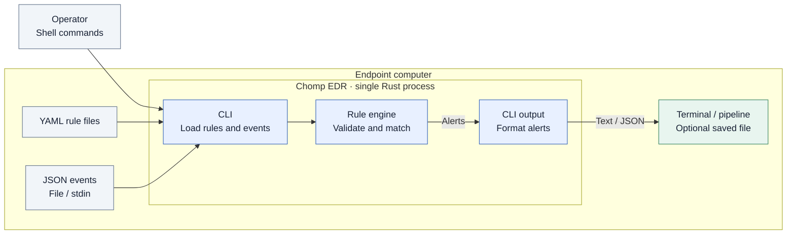

# Chomp EDR software architecture

Presentation version, October 1, 2026. Describes the implemented architecture at commit `79a7655`. The more detailed execution diagram is in [architecture.md](architecture.md).

## Slide diagram

The diagram emphasizes the scan workflow. The outer box represents the endpoint computer; the inner box represents one Rust process. Arrows show input and result flow. Output formatting belongs to the CLI, not a separate service. Library dependencies and future scope appear in a short footer to keep the diagram readable on a slide.

**Slide footer:** Libraries: Clap, Serde, serde_yaml_ng, serde_json, regex. Planned: live collection, event correlation, automated response, SIEM integration.

Use the diagram across most of the slide width. Put the footer underneath rather than adding more boxes. Explain validation, exclusions, and the separate `validate` / `list-rules` commands verbally; they are intentionally omitted from this scan-focused view.

## Text to place beside the diagram

**Chomp EDR Software Architecture**

- One Rust executable runs locally on the endpoint.
- The CLI loads YAML rules and streams JSON events to a reusable detection engine.
- The engine evaluates conditions and exclusions; the CLI displays alerts or sends them to shell pipelines.
- Current scope: stateless detection. Live collection, event correlation, automated response, and SIEM integration are planned.

## Speaker notes (approximately 45 seconds)

Chomp EDR currently runs as a single Rust program on an endpoint. The outer box represents the computer, and the inner box shows the components inside our executable. The operator interacts through a terminal. Our CLI loads YAML rules and reads structured events from a file or standard input. The rule engine validates those rules, compiles patterns, and checks each event against the configured conditions and exclusions. Results return through the CLI as readable text or JSON, which the shell can save to a file. Third-party libraries handle argument parsing, serialization, and pattern matching. This version evaluates events independently; live collection and automated response are future additions.

## Scope and presentation guidance

The diagram shows actual code boundaries, local storage, user interaction, and third-party dependencies. All library dependencies run inside the same process; none is a remote service. No database or network service is required by the current implementation. The core is intended for UNIX deployment and its automated tests have also run on Windows and macOS. The endpoint label does not imply that live OS telemetry collection already exists.

Use the diagram for the assignment's Software Architecture section. For the separate User Interface Designs subsection, show a terminal example of `chomp scan` and its alert output. Keep detailed test counts and milestone status on the Project Progress slide.
